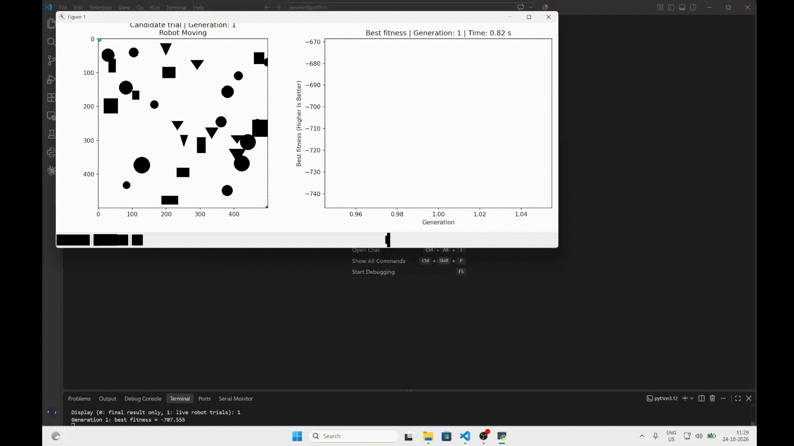
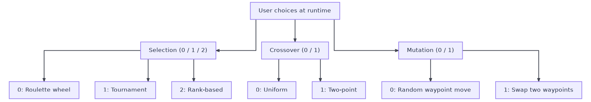
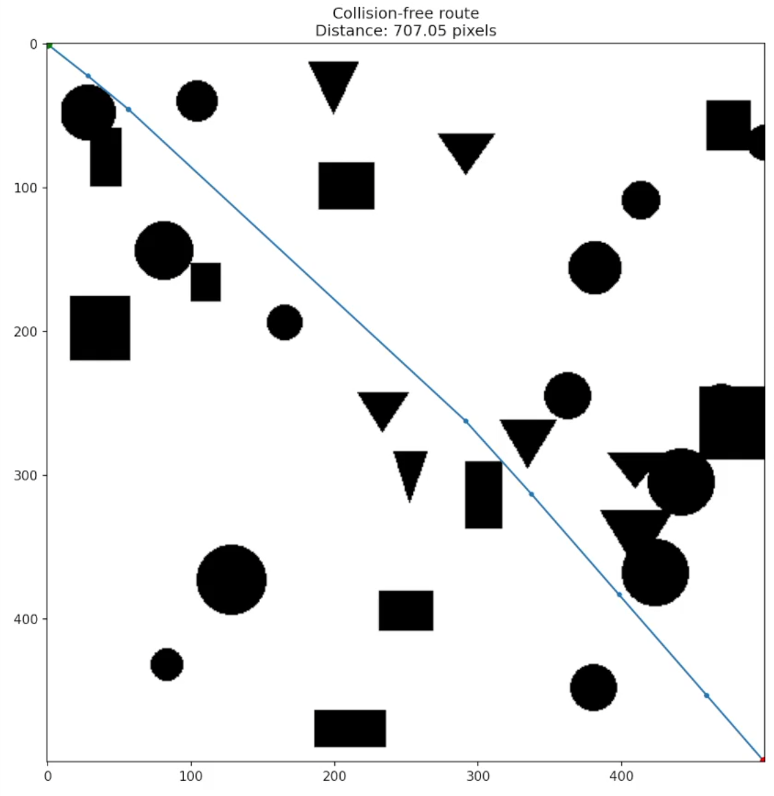
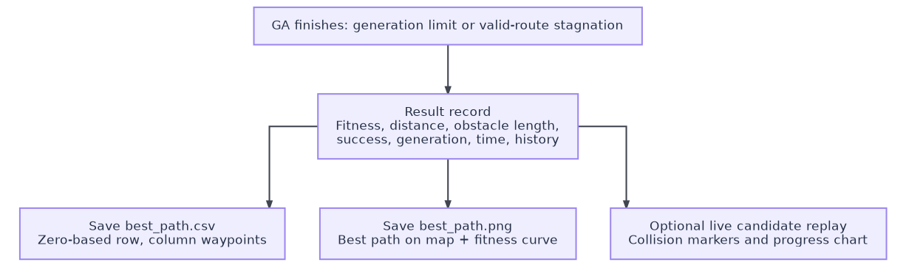
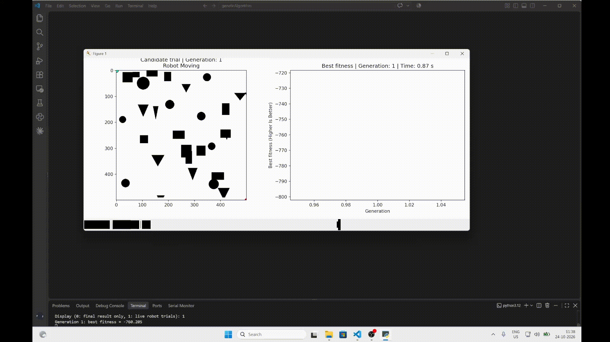
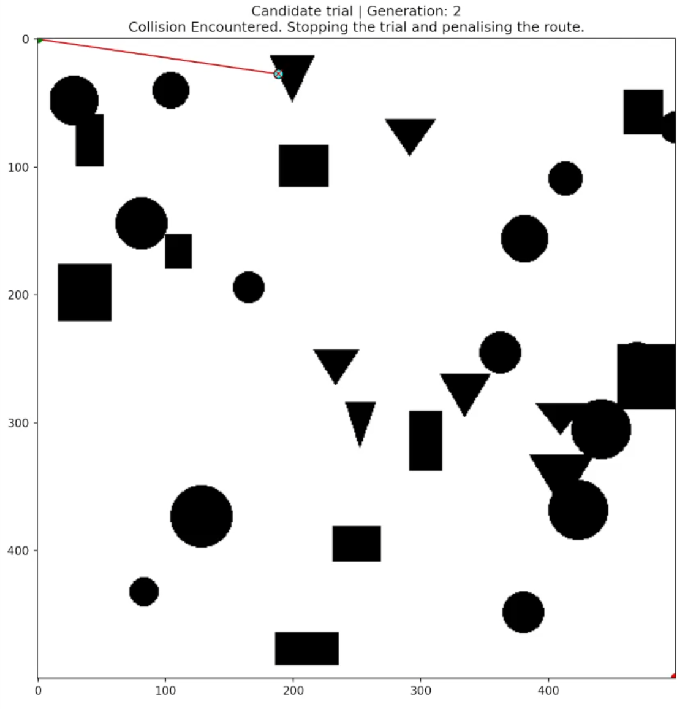
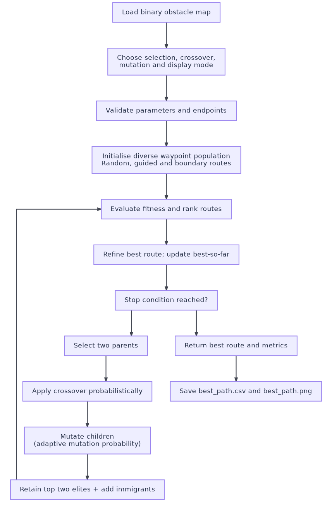
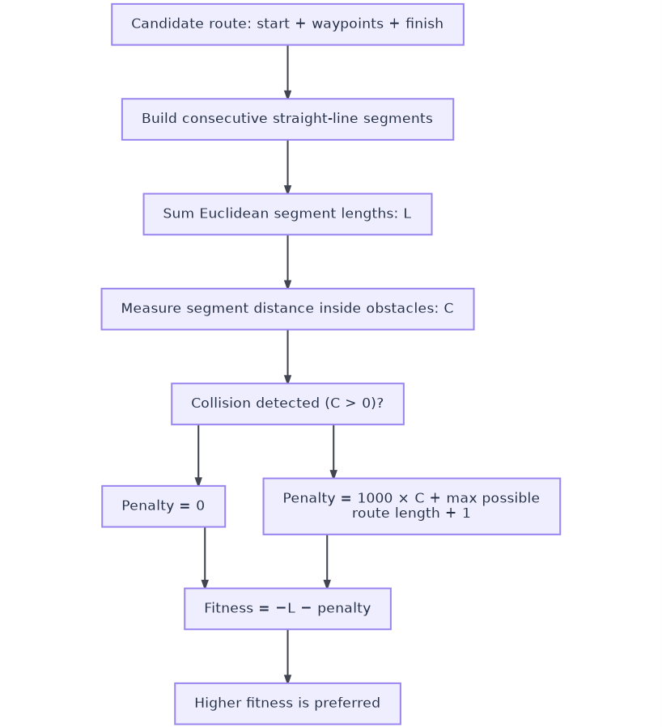
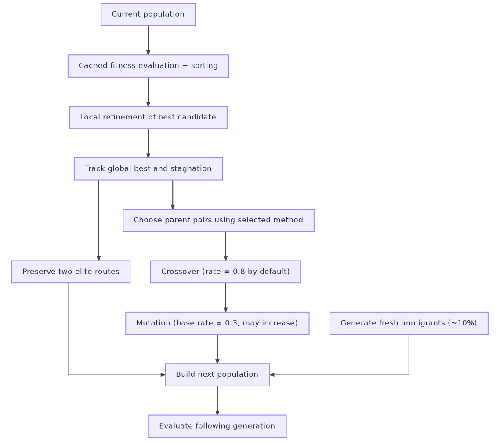
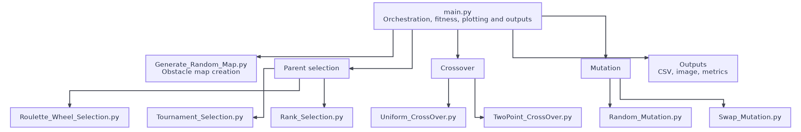

# Genetic Path Finding Algorithm

I built this project to explore how a genetic algorithm can plan a short, collision-free route through a two-dimensional obstacle map. Each candidate route is a sequence of waypoints connecting a fixed start and finish. My implementation evolves these routes using selectable parent selection, crossover, and mutation operators, with penalties for crossing obstacles.



The project includes a map generator, interactive operator selection, optional animated robot trials, a fitness history plot, and saved route coordinates. I model the robot as a point moving along straight segments in a static map and search for an optimal route.

This animation shows one recorded run. The route, distance, and runtime can vary between runs.

## Table of Contents

- [Features](#features)
- [Requirements](#requirements)
- [Installation](#installation)
- [Start the Program](#start-the-program)
- [Operator Choices](#operator-choices)
- [Results and Output Files](#results-and-output-files)
- [Images and Videos](#images-and-videos)
- [Generate or Supply a Map](#generate-or-supply-a-map)
- [How the Algorithm Works](#how-the-algorithm-works)
- [Configuration and Python Usage](#configuration-and-python-usage)
- [Project Files](#project-files)
- [Troubleshooting](#troubleshooting)

## Features

- Three selection methods: roulette wheel, tournament, and rank selection.
- Two crossover operators: uniform and two-point crossover.
- Two mutation operators: random waypoint movement and waypoint swapping.
- Mixed initial routes, including random, guided, and boundary routes.
- Two retained elite routes and fresh routes in each new population.
- Local refinement of the strongest route and adaptive mutation during stagnation.
- Segment collision checks that account for thin obstacles and obstacle corner contacts.
- Optional live animation showing candidate trials, collisions, and best fitness.
- Final route image, CSV coordinates, distance, elapsed time, and generation statistics.
- Seeded random number generation for repeatable experiments through the Python API.

## Requirements

Use a local Python installation and a terminal. A desktop graphical session is needed for the interactive plots.

| Requirement | Purpose | Download or Installation |
| --- | --- | --- |
| Python 3 | Runs the program. The existing project environment uses Python 3.12.10 | [Official Python downloads](https://www.python.org/downloads/) |
| pip and venv | Install packages in an isolated environment | Included with standard Python installers. See the [venv documentation](https://docs.python.org/3.12/library/venv.html) |
| NumPy | Coordinates, distances, populations, and random choices | Installed from `requirements.txt` |
| Matplotlib | Map display, animation, fitness graph, and image export | Installed from `requirements.txt` |
| Pillow | Reads and creates map images. Imported as `PIL` | Installed from `requirements.txt` |

I listed the dependencies  in `requirements.txt`. Python 3.12 is a useful baseline when reproducing my project environment. No GPU or external map download is required. The repository includes `random_map.bmp`.

## Installation

### 1. Install Python

Download Python from the link above and follow the installer for your operating system. On Windows, make the Python commands available on PATH if the installer offers that option, then open a new terminal.

Check the installation in Windows PowerShell:

```powershell
python --version
python -m pip --version
```

If Windows recognizes `py` instead of `python`, use `py` for these checks and for creating the environment below.

On macOS or Linux:

```bash
python3 --version
python3 -m pip --version
```

### 2. Download the Repository

On the repository's GitHub page, choose **Code > Download ZIP**, extract the archive, and open a terminal in the extracted folder containing `main.py` and `requirements.txt`.

Alternatively, install Git, copy the repository's HTTPS URL from **Code**, and clone it. Replace the example URL below with that copied URL:

```bash
git clone https://github.com/YOUR-USERNAME/YOUR-REPOSITORY.git geneticAlgorithm
cd geneticAlgorithm
```

Keep the Python modules together in the project folder. Keep `random_map.bmp` there too, and preserve the `assets` folder for the documentation media.

### 3. Create a Virtual Environment and Install Packages

Run the commands for your operating system from the project folder. These commands call the environment's Python directly, so activating the environment is optional.

Windows PowerShell:

```powershell
python -m venv .venv
.\.venv\Scripts\Activate
pip install -r requirements.txt
```

If you use the Windows Python launcher, the first command can be `py -3.12 -m venv .venv` when Python 3.12 is installed.

macOS or Linux:

```bash
python3 -m venv .venv
./.venv/bin/python -m pip install --upgrade pip
./.venv/bin/python -m pip install -r requirements.txt
./.venv/bin/python -c "import numpy, matplotlib, PIL"
```

Package installation requires an internet connection. Once installed, the program runs locally without a network connection.

After activation, `python main.py` runs with that environment. Use `deactivate` when finished. If PowerShell blocks activation, continue using the explicit `.venv\Scripts\python.exe` commands. Activation is not required.

## Start the Program

The included map is ready to use. From the project folder, run:

Windows PowerShell:

```powershell
.\.venv\Scripts\python.exe main.py
```

macOS or Linux:

```bash
./.venv/bin/python main.py
```

Answer the four terminal prompts by entering one integer and pressing Enter each time:

```text
Selection (0: roulette, 1: tournament, 2: rank): 1
Crossover (0: uniform, 1: two-point): 1
Mutation (0: random, 1: swap): 0
Display (0: final result only, 1: live robot trials): 0
```

In this example, I use tournament selection, two-point crossover, random mutation, and the final-result display. Choose display `1` to watch candidate routes being tested. Invalid menu entries prompt you to try again.

I set the defaults to 80 individuals, 10 intermediate waypoints, and at most 300 generations. The start is the top-left pixel and the finish is the bottom-right pixel. For a 500 by 500 map, these coordinates are `[0, 0]` and `[499, 499]`.

Wait for the terminal summary and final plot. The final plot remains open until you close it. The program saves `best_path.csv` and `best_path.png` beside `main.py`, even when launched from another directory. Each completed run replaces those two files, so copy them elsewhere before running again if you want to keep a result.

I use interactive prompts rather than command-line flags for selecting operators or changing parameters. Use the prompts for an ordinary run or the Python API below for additional settings.

## Operator Choices

| Prompt | Value | Method | Behavior |
| --- | --- | --- | --- |
| Selection | `0` | Roulette wheel | Shifts fitness values into positive weights and samples proportionally. |
| Selection | `1` | Tournament | Samples distinct contenders and tries them from strongest to weakest, using a selection probability. |
| Selection | `2` | Rank | Samples according to fitness rank. Equal scores receive equal average ranks. |
| Crossover | `0` | Uniform | Independently exchanges each complete waypoint with a 50% probability. |
| Crossover | `1` | Two-point | Exchanges a contiguous section between two distinct waypoint boundaries. |
| Mutation | `0` | Random | Attempts to move one waypoint, usually nearby and occasionally across the map. |
| Mutation | `1` | Swap | Exchanges two distinct waypoint positions in the route. |
| Display | `0` | Final result | Shows the final route and fitness history after the search. |
| Display | `1` | Live trials | Animates selected candidates during the search, then shows the final result. |

All 12 selection/crossover/mutation combinations are selectable. Their performance depends on the map and random choices.



In random mutation, I check that the proposed waypoint is free and at least 2 pixels from the other intermediate waypoints. This does not guarantee that the connecting segments are clear, so I check those segments during full-route evaluation. Swap mutation changes waypoint order without introducing new coordinates. I apply the same local refinement step to both mutation choices, which can introduce new coordinates.

## Results and Output Files

The terminal reports:

| Metric | Meaning |
| --- | --- |
| `Collision-free` | `True` only when the returned route has no detected obstacle intersection or contact. |
| `Distance` | Sum of Euclidean segment lengths, in pixels. |
| `Distance inside obstacles` | Total detected obstacle overlap. Corner contact can contribute a tiny positive collision marker. |
| `Time` | Search time in seconds, including initialisation and live drawing when enabled. |
| `Generations` | Number of generations evaluated. |
| `best generation` | Generation in which the best stored route last improved. |

I print progress at generation 1 and every 25 generations. Runtime depends on the map, configuration, hardware, and animation. I exclude final CSV writing and the final result plot/export from the reported search time.

| Output | Contents |
| --- | --- |
| `best_path.csv` | Header `row,column (zero-based)` followed by the start, intermediate waypoints, and finish as integer coordinates. With 10 intermediate waypoints there are 12 data rows. |
| `best_path.png` | The final route over the map beside the best-fitness history. |
| Plot window | The final visualization. Live mode reuses its window if still open. |



A valid final route is blue. A colliding final route is red. Green and red markers indicate the start and finish. Higher fitness is better, so a negative score closer to zero is preferable. For a collision-free route, fitness equals negative route length.



Output files are also written when the search fails to find a valid route. Check `Collision-free` or the API's `success` field before treating the coordinates as usable.

## Images and Videos

The images and both animated demonstrations are stored in `assets`.

### Demonstration

In live mode, a cyan marker follows an orange trial trail. A collision turns the trail red and leaves a red collision mark. A candidate that reaches the finish turns blue. Collision marks remain visible across subsequent trials. The animation shows early generations and then samples generations at intervals.



I use the fitness graph to track the best route found so far, while the animated candidate can be worse or collide. At the end, I replay the best stored route before drawing the final result. A collision stops that candidate's displayed motion at its first contact. I still evaluate the entire route when computing fitness.



The successful route in [Results and Output Files](#results-and-output-files) is an example of the final path display.

## Generate or Supply a Map

### Generate a New Random Map

This step is optional and replaces the included `random_map.bmp`. Make a copy of the existing map first if you want to keep it.

Windows PowerShell:

```powershell
.\.venv\Scripts\python.exe Generate_Random_Map.py
```

macOS or Linux:

```bash
./.venv/bin/python Generate_Random_Map.py
```

I configured the default generator to create a 500 by 500 grayscale map with 30 randomly selected rectangles, circles, or triangles. Shapes may overlap or be clipped at the map edges. I clear a corridor down the left edge and along the bottom, up to 10 pixels wide, to provide a traversable boundary route. Close the map preview, then run `main.py` again.

To control map generation without editing a source file, activate the environment, open `python` from the project folder, and run:

```python
from Generate_Random_Map import Generate_Random_Map

map_data = Generate_Random_Map(
    image_size=500,
    num_shapes=30,
    seed=42,
    output_path="example_map.bmp",
    show=False,
)
```

This saves a separate map in the current directory and returns a Boolean map array. `main.py` still loads `random_map.bmp`. Use `load_map("example_map.bmp")` with the API to plan on the separate file. The generator requires `image_size >= 2` and `num_shapes >= 0`.

### Supply Your Own Image

For the interactive program, place your image as `random_map.bmp`, replacing the old map after keeping any desired backup. Use an image editor to save it in BMP format.

- White or light pixels are free space, and black or dark pixels are obstacles.
- The loader converts the image to grayscale and treats values `>= 128` as free.
- Both image dimensions must be at least 2 pixels. The loader and planner can use rectangular maps too.
- Coordinates are zero-based `(row, column)` pairs: rows increase downward and columns increase to the right.
- The default top-left and bottom-right pixels must be free. Custom endpoints are available through the API.
- All intermediate coordinates must remain inside the map, and every connecting segment is checked for collisions.

The generator's boundary-route guarantee applies to its own generated maps. A custom map may be disconnected or may require more turns than the waypoint budget can represent.

## How the Algorithm Works

### Route Representation and Initialisation

I represent an individual as an integer NumPy array of shape `(num_way_points, 2)`. Each row stores one intermediate `(row, column)` coordinate. I add the start and finish separately, giving `num_way_points + 1` straight segments.



For initialisation, I mix free-cell samples sorted by progress toward the finish, interpolated bends, and perturbed straight-line routes. I add two boundary seeds and replace part of the population with guided routes. Guided initialisation samples visible bends that move toward the goal. I still evaluate every seed for collisions normally.

### Distance, Collision Checks, and Fitness

I split each segment at pixel boundaries and measure the portions inside blocked cells. I also check obstacle corner contacts so a diagonal gap between touching obstacles is not treated as clear. I represent contact with no positive geometric overlap using a small positive value, `1e-6`.

The following notation describes the score:

```text
L = total Euclidean route length
C = total obstacle length, including tiny positive collision markers
M = (number of segments) * sqrt((height - 1)^2 + (width - 1)^2)

penalty = 0                         if C == 0
penalty = 1000 * C + M + 1          if C > 0

fitness = -L - penalty
```



I add the extra `M + 1` penalty to ensure that a colliding route scores below any collision-free route with the same waypoint budget on the same map. Among valid routes, shorter is better.

### Generation Updates and Stopping

In each generation, I evaluate and rank the population, then locally refine the strongest route. During refinement, I try midpoint shortcuts and random waypoint movements, accepting only improvements. I store the best-so-far route and fitness history separately.

For the next generation, I keep two elites, produce children using the selected operators, and add roughly 10% fresh routes. I generally decrease movement size over time, with a larger move scale every tenth generation. I increase mutation probability during stagnation, subject to a cap of 0.8, and cache repeated route evaluations within a run.



I stop the search at `max_generations`, or earlier when there have been `no_change_limit` generations without a meaningful improvement and the best route is collision-free. I use a tolerance of `1e-9` for improvements. Stagnation alone does not terminate a run whose best route still collides.

## Configuration and Python Usage

I use the interactive entry point to ask for operators and display mode. For other settings, import `run_genetic_algorithm` without changing the supplied source files. Importing `main` does not start the interactive prompts.

### Search Parameters

| Parameter | Default | Meaning |
| --- | --- | --- |
| `selection` | `1` | `0`: roulette, `1`: tournament, `2`: rank. |
| `crossover` | `1` | `0`: uniform, `1`: two-point. |
| `mutation` | `0` | `0`: random movement, `1`: swap. |
| `population_size` | `80` | Individuals per generation, with a minimum of 4. |
| `num_way_points` | `10` | Intermediate waypoints per individual, with a minimum of 1. |
| `max_generations` | `300` | Maximum evaluated generations, with a minimum of 1. |
| `crossover_rate` | `0.8` | Probability of crossing a selected parent pair, ranging from 0 to 1. |
| `mutation_rate` | `0.3` | Base probability of mutating a child, ranging from 0 to 1, adjusted during stagnation. |
| `no_change_limit` | `70` | Stagnant generations before early stopping is allowed for a valid route, with a minimum of 1. |
| `seed` | `None` | Integer for repeatability, or `None` for unseeded runs. |
| `tournament_size` | `5` | Contenders, capped at the population size, with a minimum of 1. |
| `tournament_probability` | `0.8` | Probability of choosing each ranked contender before the final fallback, ranging from 0 to 1. |
| `start_point` | `[0, 0]` | Free integer `(row, column)` coordinate inside the map. |
| `end_point` | Bottom-right pixel | Free integer `(row, column)` coordinate inside the map. |
| `verbose` | `True` | Print periodic generation progress. |
| `show_live` | `False` | Animate sampled candidate trials. |
| `live_interval` | `5` | Generation interval for animation after the first five generations, with a minimum of 1. |
| `live_delay` | `0.02` | Positive animation frame delay in seconds. |

Tournament settings affect tournament selection only. At probability `1`, it chooses the best sampled contender. At `0`, it falls through to the weakest sampled contender. In the CLI, I explicitly pass the four menu choices and leave the seed unset.

### Run a Repeatable Search and Save a Plot

Activate your virtual environment, start `python` in the project folder, and paste this example:

```python
from main import load_map, run_genetic_algorithm, plot_result

map_data = load_map("random_map.bmp")
result = run_genetic_algorithm(
    map_data,
    selection=1,
    crossover=1,
    mutation=0,
    population_size=80,
    num_way_points=10,
    max_generations=300,
    seed=42,
    show_live=False,
)

print("Collision-free:", result["success"])
print("Distance:", result["distance"])
print("Seconds:", result["elapsed_seconds"])
plot_result(map_data, result, output_path="seed_42.png", show=False)
```

In this example, I save `seed_42.png` in the current directory and close the figure without displaying a window. To see the result, use `show=True` instead. Use the same map, parameters, seed, and software environment when comparing repeatable runs. I use separate seeds for map generation and planning.

For custom endpoints, pass values such as `start_point=[10, 10]` and `end_point=[450, 450]` only if those cells are free and inside your map. To try another operator combination, change the corresponding numeric arguments in the call.

I designed `run_genetic_algorithm` to return data without automatically writing files. Its result dictionary contains:

| Key | Contents |
| --- | --- |
| `path` | NumPy array containing the start, intermediate waypoints, and finish. |
| `fitness` | Final best score, including any collision penalty. |
| `distance` | Total route length in pixels. |
| `obstacle_length` | Total detected obstacle overlap/contact measure. |
| `success` | Whether the best path is collision-free. |
| `generations` | Number of evaluated generations. |
| `best_generation` | Generation of the last best-route improvement. |
| `elapsed_seconds` | Search duration, including live drawing if enabled. |
| `fitness_history` | Best-so-far fitness for each evaluated generation. |
| `seed` | The supplied planning seed. |
| `live_figure` | Matplotlib figure, present only when live mode was enabled. |

To export the coordinates yourself:

```python
import numpy as np

np.savetxt(
    "seed_42_path.csv",
    result["path"],
    fmt="%d",
    delimiter=",",
    header="row,column (zero-based)",
    comments="",
)
```

For a server without a display, choose the noninteractive Matplotlib backend before importing `main`, keep `show_live=False`, and save with `show=False`:

```python
import matplotlib
matplotlib.use("Agg")

from main import load_map, run_genetic_algorithm, plot_result

map_data = load_map("random_map.bmp")
result = run_genetic_algorithm(map_data, seed=42, show_live=False)
plot_result(map_data, result, output_path="headless_result.png", show=False)
```

### Choosing Settings

Increase `num_way_points` when a route needs more bends, recognizing that more coordinates make the search larger. Increase `population_size` or `max_generations` to give the search more opportunities, at the cost of runtime. Try multiple seeds on a fixed map before judging an operator combination. Use `show_live=False` for timing comparisons because animation adds display delays.

## Project Files

| File or Folder | Role |
| --- | --- |
| `main.py` | Map loading, route evaluation, population generation, operator dispatch, local refinement, search loop, animation, plotting, interactive prompts, and result export. |
| `Generate_Random_Map.py` | Generates obstacle images and clears a left/bottom boundary corridor. |
| `Roulette_Wheel_Selection.py` | Positive shifted fitness weights for roulette sampling. |
| `Tournament_Selection.py` | Configurable probabilistic tournament selection. |
| `Rank_Selection.py` | Rank-weighted selection with average ranks for ties. |
| `Uniform_CrossOver.py` | Independent exchanges of complete waypoint pairs. |
| `TwoPoint_CrossOver.py` | Exchange of a contiguous waypoint section. |
| `Random_Mutation.py` | Local or global waypoint movement with free-cell and spacing checks. |
| `Swap_Mutation.py` | Exchange of two waypoint positions. |
| `random_map.bmp` | Input map used by the interactive entry point. |
| `requirements.txt` | Python package dependencies. |
| `assets/` | Eight explanatory/result images and two animated GIF demonstrations used in this guide. |
| `best_path.csv` | Route coordinates written by the latest interactive run. |
| `best_path.png` | Result visualization written by the latest interactive run. |



I keep map generation as a separate optional step. `main.py` loads the existing bitmap without automatically regenerating it.

## Troubleshooting

| Problem | What to do |
| --- | --- |
| `python` is missing or opens the Windows Store | Install Python, reopen the terminal, and check PATH. Try `py` on Windows or `python3` on macOS/Linux. |
| `No module named venv` or an `ensurepip` error on Linux | Install your distribution's Python venv support, often named `python3-venv` on Debian/Ubuntu, then recreate the environment. |
| `ModuleNotFoundError` for `numpy`, `matplotlib`, or `PIL` | Install `requirements.txt` using the same environment interpreter that runs `main.py`. The package providing `PIL` is Pillow. |
| PowerShell blocks `Activate.ps1` | Skip activation and call `.\.venv\Scripts\python.exe` directly. |
| The virtual environment no longer starts after moving the project | Create a fresh environment with the installed Python and reinstall requirements. Environments are machine/path dependent. |
| `random_map.bmp` cannot be found | Keep it beside `main.py`, or run `Generate_Random_Map.py` to create it. API examples use paths relative to your current directory. |
| The start or finish is blocked | Clear the endpoint pixels in your map or pass free custom endpoints through the API. |
| No plot window appears | Use a local graphical session with a GUI-capable Matplotlib backend. For headless execution, use the API example above. |
| A Tk backend error appears | Install the matching Tk support for your Python distribution. Linux packages are often named `python3-tk`. |
| The live run seems slow | Let the animation finish or select display `0`. Closing the live window stops its drawing while the search continues. |
| `Collision-free: False` | Try another seed, more waypoints, a larger population, or more generations through the API. Check that a route exists in the map. |
| The terminal appears to wait after printing results | Close the final Matplotlib window to let the program exit. |